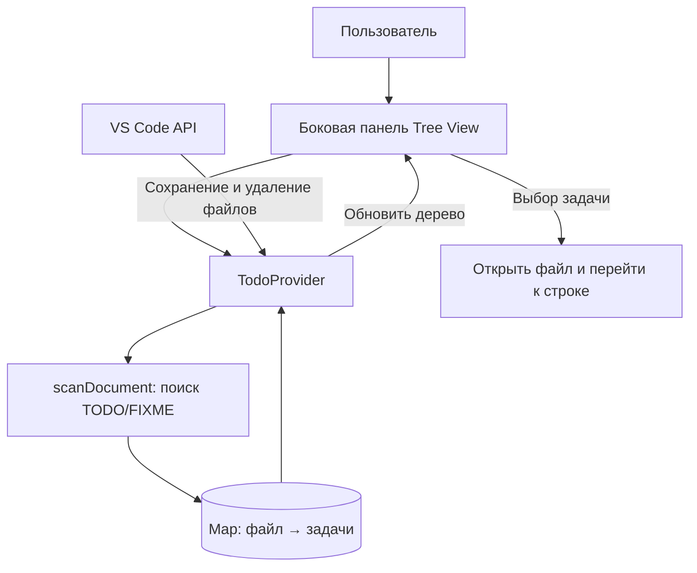
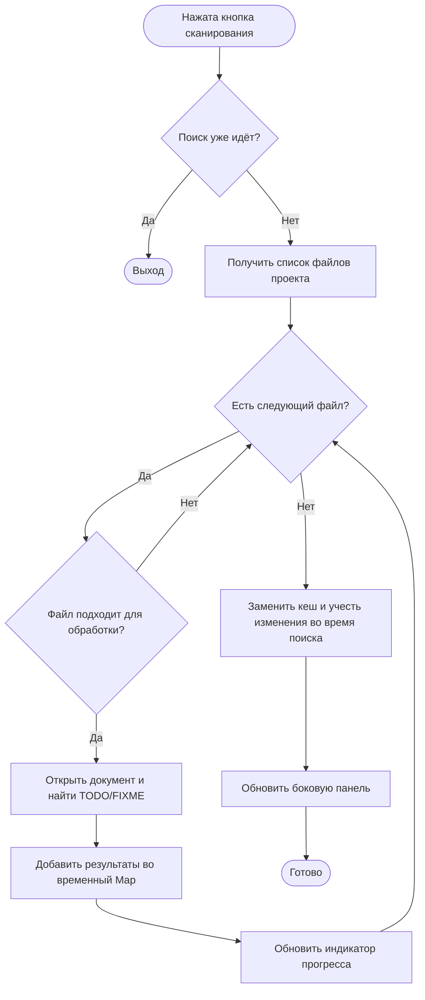
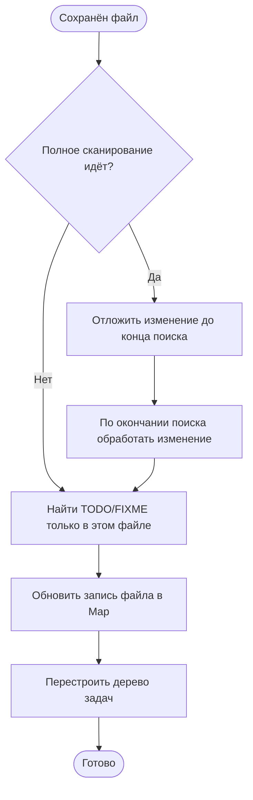

# TODO Explorer — ТЗ и архитектура

**IDE:** Visual Studio Code  
**Язык:** TypeScript

## 1. Краткое ТЗ

**Назначение:** поиск пометок `TODO` и `FIXME` в комментариях исходного кода с удобной навигацией по проекту.

Плагин должен:

1. По нажатию кнопки сканировать текстовые файлы открытого проекта и находить `TODO`/`FIXME`.
2. Показывать результаты в боковой панели: файл → задачи (тип, текст, номер строки).
3. Открывать файл на нужной строке при выборе задачи.
4. Показывать прогресс поиска и сообщение, если сканирование ещё не запускалось или ничего не найдено.
5. Автоматически обновлять задачи сохранённого файла и убирать результаты удалённых через VS Code файлов.

## 2. Подключение к VS Code

В `package.json` объявлены команды и боковая панель (**Tree View**). При запуске VS Code вызывает `activate()` в `src/extension.ts`. Эта функция регистрирует `TodoProvider`, команды сканирования и перехода к задаче, а также обработчики сохранения и удаления файлов через **VS Code Extension API**.

**Основные структуры данных:** `TodoItem` хранит текст задачи, тип, номер строки и URI файла; `Map<string, TodoItem[]>` связывает каждый файл с найденными в нём задачами. Узлы `FileNode` и `TaskNode` формируют дерево панели.

## 3. Блок-схема полного сканирования

Из поиска исключены служебные каталоги (`.git`, `node_modules`, `build` и др.) и файлы размером более 1 МиБ. Поиск комментариев выполняется построчно с помощью регулярного выражения.

## 4. Блок-схема обновления при сохранении

Такой подход не требует повторно сканировать весь проект после каждого сохранения. Результаты хранятся в памяти; для повторного полного поиска используется кнопка «Сканировать проект».

## 5. Документация

Инструкция по установке и описание возможностей находятся в `README.md`. Документация методов создаётся из JSDoc-комментариев с помощью TypeDoc (`npm run docs`).
